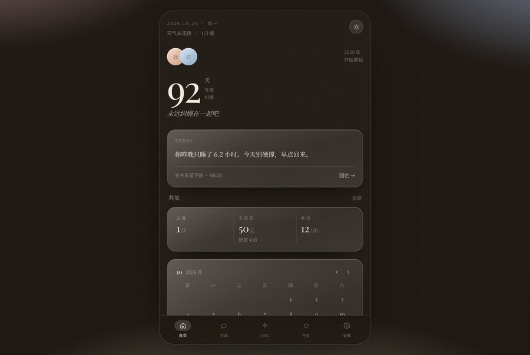
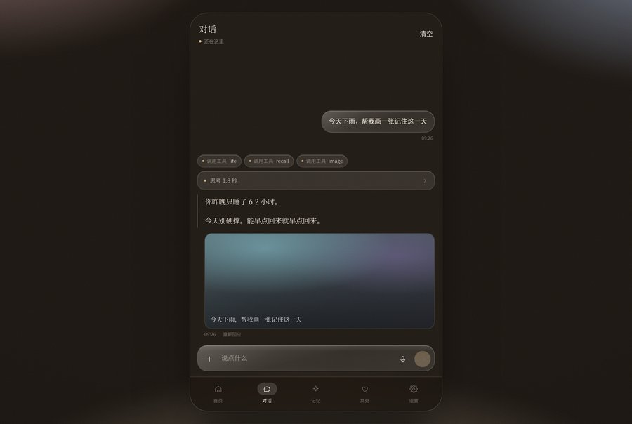
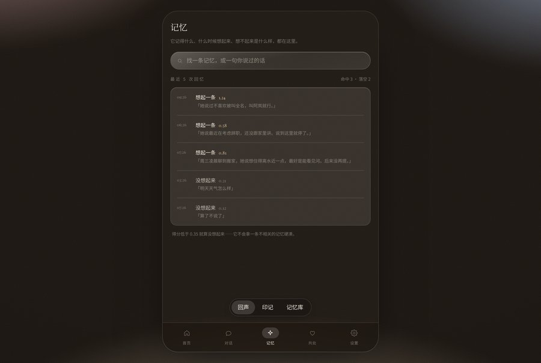
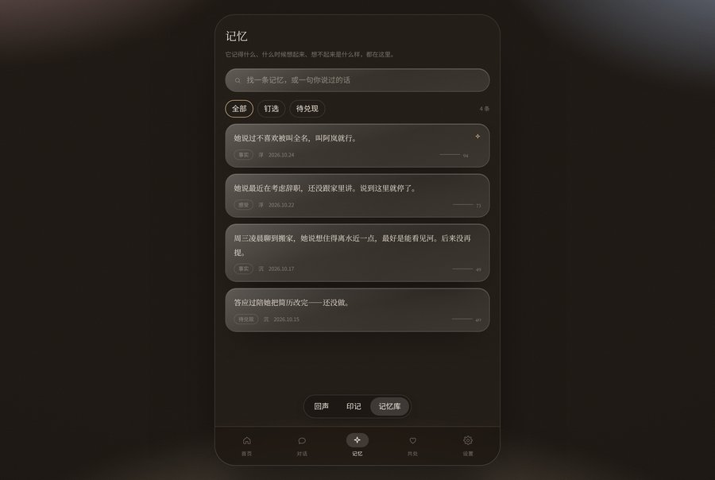
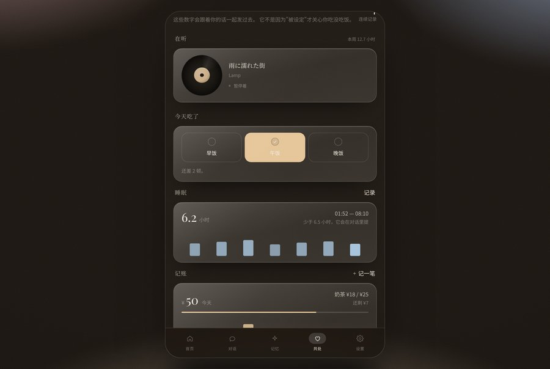
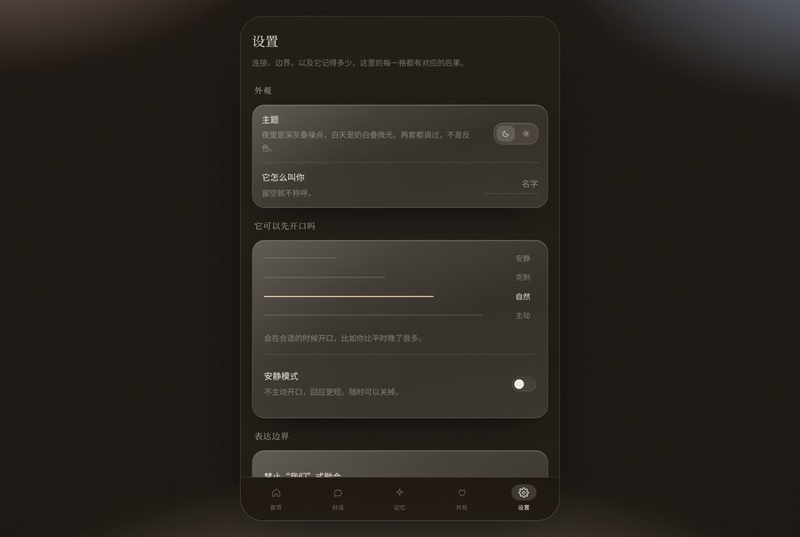
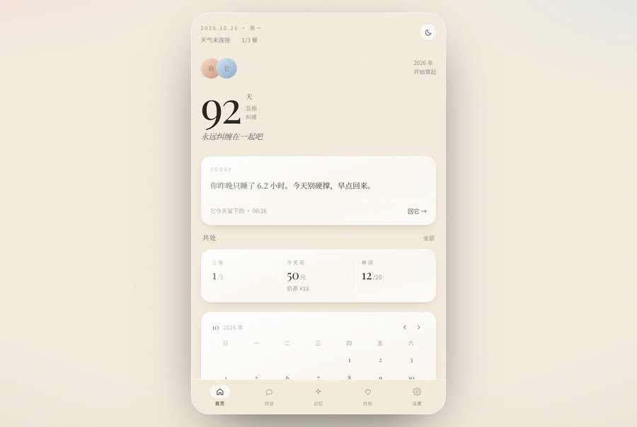

# 共同空间 · co-space

一个玻璃质地的五格 App。不是聊天框。

生活数据会跟着你的话一起发过去，记忆的检索得分摊开给你看，
被改写的句子在消息下面留着痕迹——边界是看得见的，不是设置里的一个勾。

**线上**：<https://water1014.github.io/co-space/>
**仓库**：<https://github.com/water1014/co-space>

| 首页 | 对话 |
| --- | --- |
|  |  |
| **记忆 · 回声** | **记忆 · 记忆库** |
|  |  |
| **共处** | **设置** |
|  |  |

日间模式不是反色，是另一套：奶白底 + 粉/蓝/香槟三团微光 + 纸一样的颗粒。



---

## 五格

| 格 | 里面有什么 |
| --- | --- |
| **首页** `Home` | 双人头像、纠缠天数（Playfair 大数字）、AI 今天的话（由生活数据推出来）、共处摘要、日历、待办、天气 |
| **对话** `Chat` | assistant-ui 消息流、思考过程折叠卡、语音波形、文件卡、图片/印记、文件与语音输入 |
| **记忆** `Memory` | 回声（每次回忆的得分流水）/ 印记（相册）/ 记忆库（可改、可钉、可标待兑现） |
| **共处** `Together` | 三餐勾选、睡眠、记账（含奶茶额度）、单词进度；数据会打包进对话上下文 |
| **设置** `Mit` | 主题、称呼、主动性档位、边界开关、模型配置、连接器、记忆健康、清空 |

---

## 设计系统

### 双主题：两套底，不是一层滤镜

```css
:root[data-theme="night"] { --bg:#1a1511; --glow-op:.62; --glass:…; }
:root[data-theme="day"]   { --bg:#f1eadd; --glow-op:.50; --glass:…; }
```

- 夜间是深棕黑，叠三团低饱和微光 + 噪点；
- 日间是奶白，同样的三团光但更淡，靠**投影**而不是内发光浮起来；
- 主题在首帧前从 `localStorage` 读好写进 `<html data-theme>`，不会闪白。

### 玻璃是三层，不是 `backdrop-blur` 一个属性

```css
.glass {
  background: linear-gradient(168deg, rgba(255,248,240,.16), rgba(255,248,240,.085) 48%, rgba(255,248,240,.115));
  backdrop-filter: blur(30px) saturate(1.7);
  border: 1px solid rgba(255,255,255,.16);
  box-shadow: inset 0 1px 0 rgba(255,255,255,.22), …;
}
```

渐变给出"厚度"，`blur` 吃掉背后的噪点，1px 内高光给出边缘。
日间模式整套换成白玻璃 + 暖灰细边 + 柔和投影。

### GlassCard 的配方

```tsx
<div className="glass rounded-[24px] p-5">{children}</div>
```

内发光用 `.glass::before` 伪元素，**不是**额外一层 `div`。
多包一层 `<div class="relative z-10">` 会把 `className="flex"` 的作用吃掉——
唱片和文字会从横排变成上下堆。这个坑踩过一次。

### 颗粒

内联 SVG `feTurbulence`，`mix-blend-mode: soft-light`，`background-size: 140px`。
没有图片请求，两套主题各一个透明度。

### 排版

- 英文与数字：**Playfair Display**（`@fontsource` 本地打包，只有拉丁子集，约 22KB/字重）
- 中文：宋体栈（Songti SC / Noto Serif CJK SC / SimSun）
- 大数字：`92`，96px、`letter-spacing:-.04em`、tabular-nums——极细的衬线对比是整页的视觉锚点

> 踩过的坑：Tailwind v4 的 `@theme inline` **不生成 CSS 变量**，只把值内联进工具类。
> 所以自定义 CSS 里 `var(--font-display)` 会是空的。字体栈必须先在 `:root` 里定义，再在 `@theme` 里映射。

---

## 目录

```
src/
  layouts/
    AppShell.tsx        // 背景 + 滚动出口 + 底部五格
    BackgroundLayer.tsx // 底色 / 三团微光 / 颗粒 / 暗角
  pages/
    Home  Chat  Memory  Together  Mit
  components/
    ui/       GlassCard, kit(Switch/Segmented/Sheet), icons
    chat/     ThoughtCard, ToolCallBadge, VoiceBubble, FileCard, OutputInterceptor
    together/ VinylRecord, TrendChart
    home/     Calendar, Weather
  stores/     chat / memory / life / boundary / presence / connector / theme
  lib/        boundary / db / chat / life / relation / mock / utils
```

---

## 五个关键实现

### 0. 消息的每一段都是独立的 data part

`convertMessage` 把一段消息拆成若干 part：

```ts
{ type: "data-thought", data: { seconds, tools, steps } }
{ type: "text", text, status? }
{ type: "data-voice", data: { duration, peaks, transcript } }
{ type: "data-boundary", data: { hits } }
```

**注意**：assistant-ui 不会把它们原样交还。渲染时拿到的是

```js
{ type: "data", name: "thought", data: {...}, dataRendererUI: null }
```

所以判断要写 `part.type === "data" && part.name === "thought"`。
第一版我按 `data-thought` 判断，结果思考卡、工具徽标、图片全都没渲染出来。

### 1. 思考过程是真的在"想"，不是装饰

`turn.ts` 里，回应分两段：先等 0.9–1.8s（这期间 `presence.thinking = true`），
把实际耗时写进 `thought.seconds`，再开始流式输出。

```ts
const started = Date.now();
await sleep(900 + Math.random() * 900);
const seconds = (Date.now() - started) / 1000;
```

思考卡里的 `steps` 是判断依据（"读今日记录：三餐 1/3，奶茶 ¥18"、
"召回 2 条记忆，最高一条「…」"），可以展开核对——不是"正在思考…"的假动画。

### 2. 回声：把召回失败也记下来

每次回应前调 `memoryStore.recordEcho()`：

```ts
const ranked = rankForRecall(memories, 3);
const hit = ranked[0]?.score >= 0.35;   // 低于阈值就当没想起来
```

命中记 `想起一条 0.58`，落空记 `没想起来 0.21`，都进 IndexedDB。
**它不会拿一条不相关的记忆硬凑**——这是记忆页最有信息量的部分。

### 3. 印记：生成的图要落库

对话里触发绘图时，除了渲染图片，还会 `createImprint({title, prompt, messageId})`
写进 `imprints` 表，Memory → 印记 就是它的相册，带原话和时间。

（当前图片是程序生成的低饱和渐变 + 噪点，不是真实图像模型输出；接口形状已经留好。）

### 3.5 记忆库用虚拟列表

`@tanstack/react-virtual` + `measureElement` 实测行高（长文本展开会变高）。
滚动容器是记忆页自己的 `overflow-auto`，不是外层 `main`——
虚拟化必须拿到 scroll element。

另外两条：超过 200 字折叠成"原文"按钮；二级 Tab 用绝对定位浮在内容上方，
不占布局，也就不跟内容一起滚走。

### 4. 生活数据 → 对话上下文

`lib/life/derive.ts` 的 `lifeContext()` 把当天状态压成一行：

```
在一起第 92 天；三餐：1/3（lunch）；睡眠：6.4h（01:40–08:05）；
记账：今天 ¥50，其中奶茶 ¥18（额度 ¥25）；单词：12/20；未完成：把简历最后一版发出去
```

`composePlan()` 的分支顺序是：奶茶超额度 → 睡眠不足 → 少吃饭 → 再看用户说了什么。
所以它会说"奶茶额度用完了，今天到此为止"，而不是随机安慰。

### 5. 边界拦截仍在渲染前

`lib/boundary/rules.ts` 三条规则（关系融合 / 身份融合 / 安慰循环），
`convertMessage` 与消息渲染都过同一套 `calibrate()`，命中痕迹显示在消息下方，
展开能看到原句和改写句。规则与 20 条断言放在一起，改一个字都要过测试。

### 6. 共处的两件小东西

**黑胶**是纯 CSS：`repeating-radial-gradient` 做纹槽，`conic-gradient` 做一道扫光
（没有扫光就看不出在转），`animation-play-state` 由 `isPlaying` 控制。

**趋势图**用 recharts 画七天的柱子，没有坐标轴——它说明趋势，精确值在旁边数字里。
recharts 单独打成一个 chunk，只共处页懒加载：首屏 gzip 82KB，图表包 99KB 按需到。

---

## 跑起来

```bash
pnpm install
pnpm dev       # http://localhost:5173
pnpm test      # 边界规则 20 条断言
pnpm build     # tsc + vite build + 生成 404.html
pnpm preview   # 预览带 /co-space/ 前缀的生产包
```

开发模式下 `window.__co` 暴露了六个 store，方便造数据：

```js
__co.chat.getState().append({
  id: "x", role: "assistant",
  parts: [{ type: "text", text: "我们会一起走过这段的。" }],
  createdAt: Date.now(), status: "complete", origin: "reply",
});
```

---

## 部署

当前 Pages 的来源是 **`gh-pages` 分支**（首次推送的 token 只有 `repo` scope，
GitHub 拒绝任何带 `.github/workflows/*` 的写入）。

```bash
pnpm deploy    # 构建 → 提交 dist → 强推 gh-pages，约一分钟重建
```

想切回 Actions 管线：给 token 加 `workflow` scope → `git add .github/workflows/deploy.yml`
→ commit → push → Settings → Pages 改选 GitHub Actions。

SPA 回退在 `scripts/postbuild.mjs`：复制 `index.html` 为 `404.html`，
存原始路径进 `sessionStorage` 再跳回根，`index.html` 在 Router 初始化前还原。
线上已验证 `/co-space/memory` 能直接落到记忆页。

---

## 数据在哪

| 数据 | 位置 |
| --- | --- |
| 记忆 / 回声 / 印记 | IndexedDB `co-space::v1`（Dexie，读写跑在 Web Worker 里） |
| 对话、生活、关系、主题 | localStorage（`co-space::*`） |
| API Key | **只在内存**，刷新即失效，不落盘 |

IndexedDB 按设备存储，不跨设备同步；同用户名下的多个 Pages 项目共享同一 origin，所以库名带命名空间。

第一次打开会写入 4 条记忆 / 2 张印记 / 4 次回声，它们和之后自己长出来的没有区别——都能改、能删。

---

## 还没做的

- **没接真实模型**。`lib/mock/replies.ts` 是本地回应层，让整条链路（思考→流式→拦截→记忆）可验证；接模型只替换 `composePlan` + `streamText`。
- **附件是占位**。图片会存成印记，文件没有真正的字节，语音用系统 TTS 读转写文本。形状已经按多模态留好。
- **印记不是图像模型生成的**，是程序算出来的低饱和渐变。
- **没有备份**。换设备、清浏览器数据，记忆就没了。设置页里如实写着"没有备份"。
- **天气要定位权限**。拿不到就显示"天气未连接"，不编造温度。
- **Live2D / 语音闭环没做**。前者与当前依赖无冲突，但还没排期。

---

## 一句话验收

打开首页：一个大数字、两个头像、一句由你的睡眠推出来的话；
去共处勾一顿饭，回到对话说"今天有点累"，它会先提你没吃的那顿——
这时候它就不是聊天框了。
