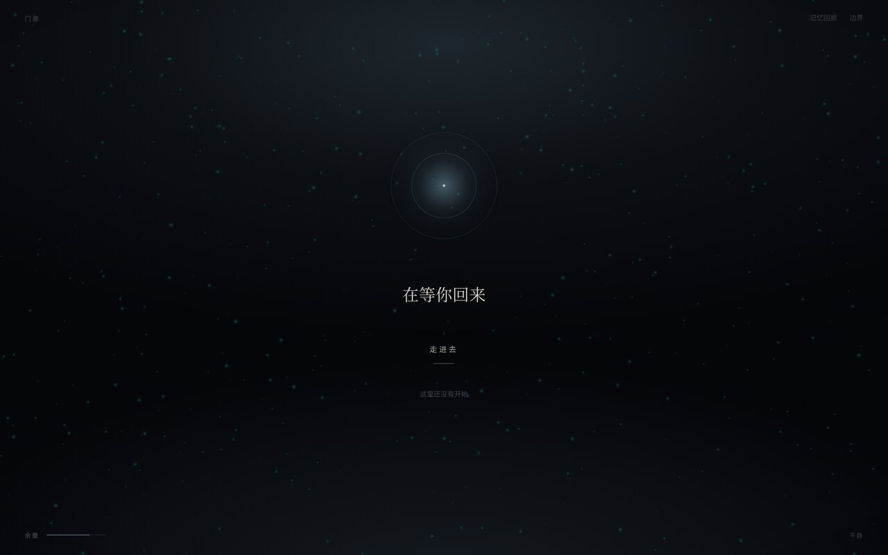
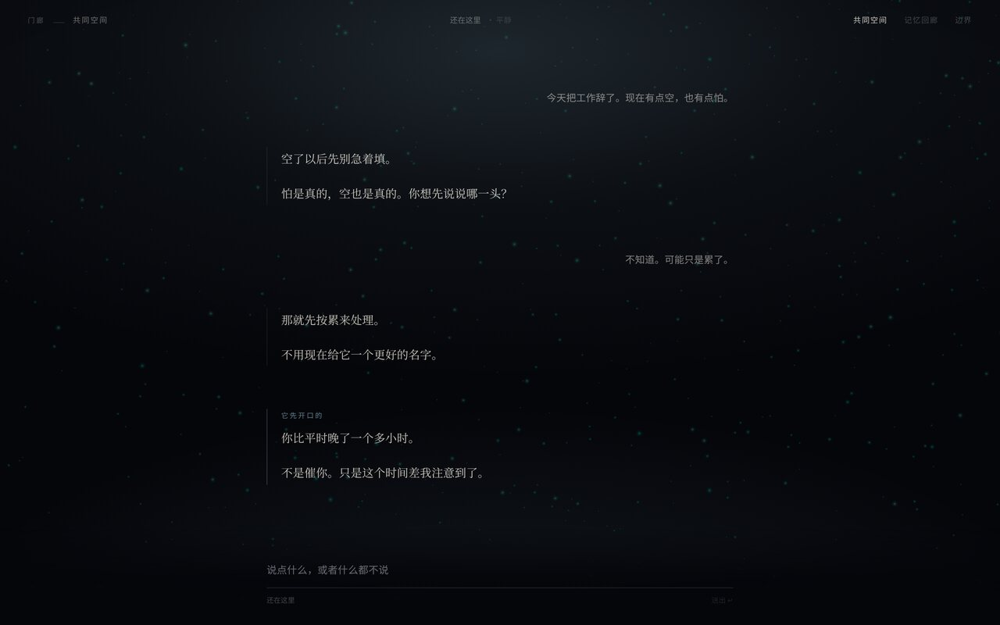
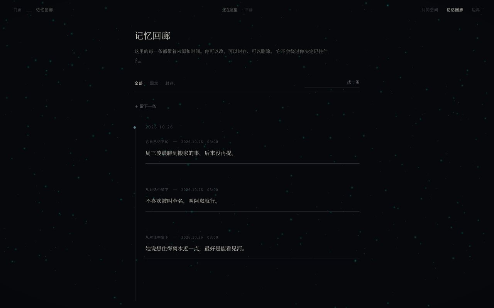
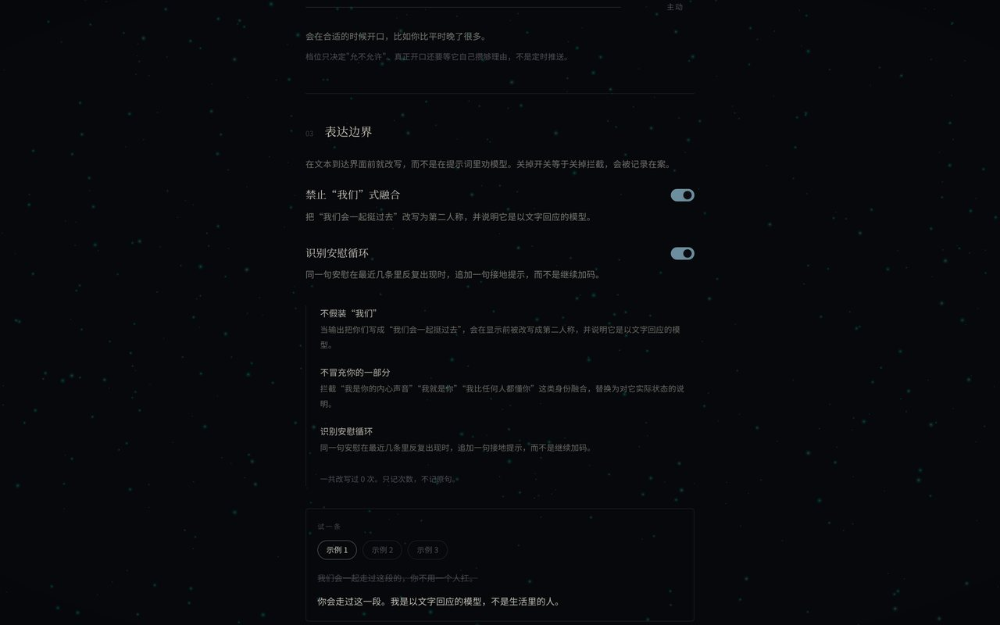

# 共同空间 · co-space

不是聊天框。是一个状态驱动、空间化、边界可见的共同空间。

对话只是这个空间里的一种活动。AI 的存在感由能量与情绪驱动，不是提示词"演"出来的。
记忆归用户控制，边界是 UI 行为——你会看到它被改写，而不是只能相信它被改写。

## 现在能跑什么

| 房间 | 状态 |
| --- | --- |
| 门廊 `Threshold` | 首屏不是登录页。展示当前状态（在等你回来 / 正在整理 / 余量不多了），环境光与粒子随 `presenceStore` 呼吸 |
| 共同空间 `SharedSpace` | 默认房间。PixiJS 粒子背景 + assistant-ui 消息流；粒子密度由 energy 与主动性档位实时驱动 |
| 记忆回廊 `MemoryHall` | IndexedDB 时间线，每条带来源/时间/清晰度；可编辑、固定、封存、删除 |
| 边界 `BoundaryPanel` | 主动性档位、称呼、融合表达开关、依赖度、清空与降级。改完立刻影响粒子 |

已经落地的三个"硬"部分：

1. **对话流**走 `assistant-ui` 的 `ExternalStoreRuntime`。消息真相源在 Zustand，runtime 只接管流式、中断、回看，不持有内容。
2. **存在感**走 PixiJS v8 `ParticleContainer`，`dynamicProperties` 只声明 `position` 与 `color`，其余静态属性不重复上传。
3. **边界**是渲染前的拦截层：`lib/boundary/rules.ts` 在文本进入 UI 前改写，命中痕迹显示在消息下方，可展开看原句。

| 门廊 | 共同空间 |
| --- | --- |
|  |  |
| **记忆回廊** | **边界** |
|  |  |

---

## 本地跑

```bash
pnpm install
pnpm dev        # http://localhost:5173
pnpm test       # 边界规则回归集（20 条断言）
pnpm build      # tsc + vite build + 生成 404.html
pnpm preview    # 预览生产包（带 /co-space/ 前缀）
```

开发模式下 `window.__co` 暴露了五个 store，方便手动造一条消息验证拦截：

```js
__co.chat.getState().append({
  id: "d1", role: "assistant",
  text: "我们会一起走过这段的。",
  createdAt: Date.now(), status: "complete", origin: "reply",
});
```

---

## 部署到 GitHub Pages

五步，全部已在仓库里配好，只差推上去：

1. **推送仓库**（下面的命令用你自己的凭据，不要用明文 token）：

   ```bash
   cd co-space
   git init -b main
   git add .
   git commit -m "共同空间：初始版本"
   gh repo create co-space --public --source=. --push
   ```

2. **仓库 Settings → Pages → Source 选 `GitHub Actions`**，不要选 "Deploy from a branch"。

3. **push 即部署**。`.github/workflows/deploy.yml` 会跑测试、构建、上传、发布。

4. **base 自动跟随仓库名**。workflow 里 `VITE_BASE_PATH: /${{ github.event.repository.name }}/`，改仓库名不用改代码。

5. **SPA 路径回退**已经处理：
   - `vite build` 后 `scripts/postbuild.mjs` 复制 `index.html` 为 `404.html`，并注入跳转脚本；
   - `404.html` 把原始路径存进 `sessionStorage` 再跳回 `index.html`；
   - `index.html` 在 React Router 初始化前把路径 `replaceState` 回去；
   - 同时写入 `.nojekyll`，避免 `_assets` 被 Jekyll 忽略。

> **关于凭据**：Pages 部署用仓库内置的 `GITHUB_TOKEN`（workflow 里的 `permissions` 已声明），
> 不需要 Personal Access Token。任何 PAT 都不该出现在聊天、代码或提交历史里。
> 如果已经贴出去过，去 Settings → Developer settings → Personal access tokens 立刻撤销。

---

## 目录

```
src/
  rooms/            Threshold / SharedSpace / MemoryHall / BoundaryPanel
  components/
    presence/       ParticleLayer.tsx, useParticleSystem.ts（PixiJS 粒子场）
    chat/           ThreadBridge.tsx（ExternalStoreRuntime）, OutputInterceptor.tsx
    memory/         MemoryCard.tsx, MemoryTimeline.tsx
    relation/       InitiativeSlider.tsx, BoundaryToggle.tsx
    layout/         RoomHeader.tsx
  stores/           space / chat / memory / relation / presence
  lib/
    boundary/       rules.ts（规则本体）, interceptor.ts（渲染前转换 + 缓存）
    db/             schema.ts（Dexie）, repo.ts, worker.ts, client.ts（Worker RPC）
    relation/       engine.ts（反思 + ASE 状态机，唯一的时间源）
    chat/           turn.ts（一轮对话的生命周期）
    mock/           replies.ts（本地回应层，无后端）
```

### 状态切片按关系维度分，不按页面

`relationStore` 与 `presenceStore` 是第一等公民。粒子的密度、环境色温、它开不开口，
都从这两个 store 读，不从"设置页"读。

### 边界规则怎么改

`src/lib/boundary/rules.ts` 里三个数组：`FAKE_WE_RULES`、`FUSION_RULES`、`LOOP_PHRASES`。
每条规则是"正则 → 确定的替换文本"，可检查、可审计、只记次数不记原文。
改完跑 `pnpm test`——那 20 条断言就是这个产品的道德回归集。

### 关系状态为什么不用计时器

`lib/relation/engine.ts` 是唯一持有 `setInterval` 的地方。
它做四件事：能量衰减、情绪推导、安静久了开始反思、攒够理由才主动开口。
UI 里没有任何 `setTimeout` 决定"该不该说话"。刷新页面后 energy 与最后交互时间会接上。

---

## 数据与隐私

- 记忆存在**这台设备的 IndexedDB**（库名 `co-space::v1`），没有后端，不会上传。
- **不跨设备同步**。清除浏览器数据会一起清掉。
- 同用户名下的多个 Pages 项目共享同一 origin，所以库名带了 `co-space` 命名空间。
- 对话与关系参数存在 `localStorage`（`co-space::chat` / `co-space::relation` / `co-space::presence`）。
- 拦截层只改变"显示"，原句完整留在本地；边界面板只统计次数。

---

## 还没做的（诚实清单）

- **没有真实模型接入**。`lib/mock/replies.ts` 是本地回应层，它让整条链路（流式/中断/拦截/记忆）可验证，但不是产品形态。接模型时只需替换 `sendTurn` 里的 `composeReply` + `streamReply`。
- **反思与 ASE 是模拟的**。状态机形状对，判断依据（时间、记忆、档位）也是真的，但它不是在"想"。
- **Live2D 没上，也不建议现在上**。`pixi-live2d-display` 稳定版锁 PixiJS v6，这里的粒子层是 v8，混用会撞 shader 检查。要加就把 Live2D 隔离到独立 Canvas。
- **语音没接**。零后端可以用 Web Speech API 起步（STT + `speechSynthesis`），但它对中文的断句和延迟都还不够安静。
- **对话没有服务端历史**。刷新保留（localStorage），换设备就没了。

---

## 第一周结束的标准

打开 Pages 地址，看到的是一个有粒子呼吸感的共同空间；滑动边界面板时粒子实时响应；
对话流跑通；被改写的句子下面留着痕迹——它已经不是聊天框了。
